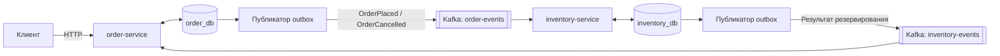
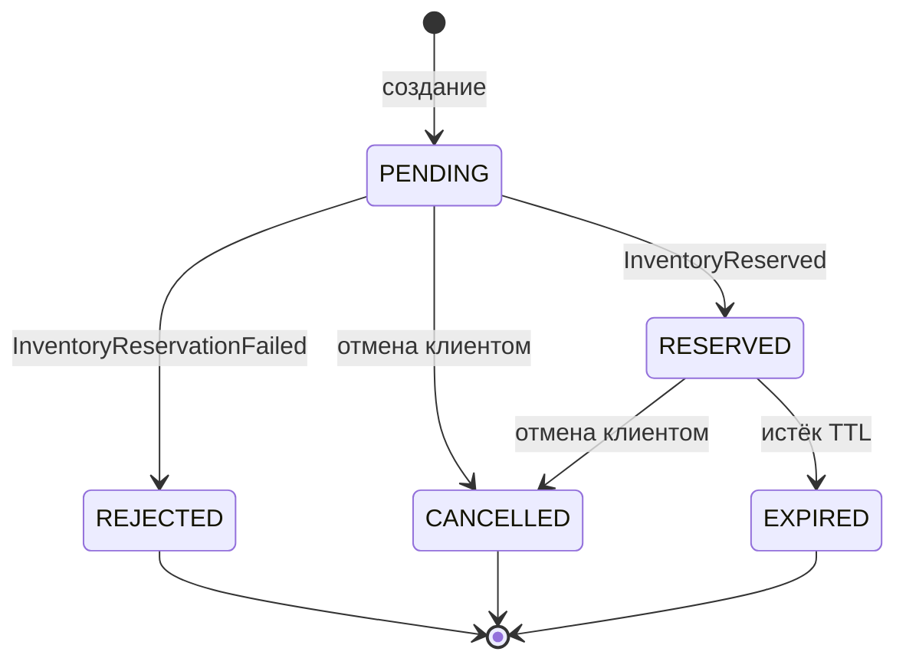
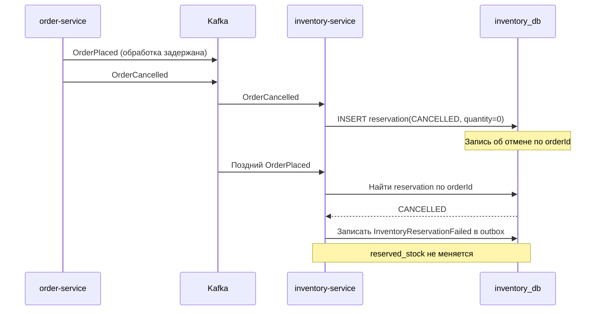

# Reservation Engine

Сервис резервирования товара, в котором один заказ содержит один артикул. Он решает проблему конкурентных заказов: если на складе осталось 20 единиц, система не подтвердит 21-е бронирование даже при одновременных запросах и повторной доставке событий. Клиент работает с `order-service` по HTTP, а `inventory-service` обрабатывает резервирование через Kafka.

## Как работает бронирование

`order-service` создаёт заказ в статусе `PENDING` и возвращает `202 Accepted`. `inventory-service` резервирует товар и сообщает результат через Kafka; внешнего REST API у него нет. У каждого сервиса своя база.



Бронирование реализовано как хореографическая сага: сервисы обмениваются событиями без центрального координатора и общей транзакции. `InventoryReserved` подтверждает заказ, `InventoryReservationFailed` отклоняет его, а `OrderCancelled` запускает освобождение брони. Состояния заказа:



`202 Accepted` означает, что заказ создан, но склад ещё может его отклонить. Бронь действует 15 минут по умолчанию. Просроченные заказы проверяются периодически, поэтому освобождение остатка происходит не ровно в `expiresAt`.

## Инвариант склада

Для каждого артикула (SKU) действует инвариант `0 ≤ reserved_stock ≤ total_stock`. Резервирование выполняется одним условным запросом (SQL-эквивалент запроса в `InventoryRepository`):

```sql
UPDATE inventory
SET reserved_stock = reserved_stock + :quantity,
    version = version + 1,
    updated_at = :now
WHERE sku = :sku
  AND total_stock - reserved_stock >= :quantity;
```

Одна изменённая строка означает успешный резерв; ноль — нехватку товара или неизвестный артикул. PostgreSQL блокирует строку и проверяет условие при конкуренции транзакций. Ограничение `CHECK` в схеме дополнительно защищает инвариант. Остаток освобождается только для брони `HELD`.

Распределённая блокировка через Redis добавила бы второй механизм синхронизации при том, что остаток хранится в PostgreSQL. Оптимистичная блокировка с `@Version` при конкуренции за один артикул приводила бы к конфликтам и повторам. Здесь решение о резерве принимает условный `UPDATE`; поле `version` лишь увеличивается вместе с остатком.

События заказа публикуются с ключом `sku`. Kafka сохраняет порядок для одинакового ключа внутри партиции, но не гарантирует общий порядок между основным топиком и топиками повторных попыток. Поэтому обработчики учитывают и дубликаты, и запоздавшие события.

## Что происходит при сбоях

Оба сервиса используют транзакционный outbox — таблицу исходящих событий. Изменение заказа или брони и запись события в эту таблицу совершаются в одной транзакции БД. Фоновый процесс выбирает пачку через `FOR UPDATE SKIP LOCKED`, отправляет события в Kafka и отмечает публикацию. Несколько экземпляров могут выбирать разные строки без взаимного ожидания.

Если процесс остановится после отправки в Kafka, но до отметки `published_at`, событие будет отправлено повторно. Доставка здесь происходит **как минимум один раз** (`at-least-once`). Поэтому обработчик сначала записывает `eventId` в той же транзакции, в которой меняет данные:

```sql
INSERT INTO processed_events (event_id, event_type, processed_at)
VALUES (:eventId, :eventType, :processedAt)
ON CONFLICT (event_id) DO NOTHING;
```

Ноль вставленных строк означает дубликат: остаток повторно не меняется. Запись брони в `reservations` защищает и от разных событий для одного `orderId`. Опрос outbox добавляет задержку (по умолчанию 500 мс) и нагрузку на БД, зато не требует отдельной инфраструктуры для чтения журнала изменений, например Debezium.

Если `OrderPlaced` задержался на повторной обработке, отмена может прийти на склад первой. Склад сохраняет запись об отмене с состоянием `CANCELLED` и нулевым количеством — tombstone. Поздний `OrderPlaced` уже не резервирует товар: склад отправляет отказ `ORDER_ALREADY_CANCELLED`.



Ключевая развилка обработчика:

```java
if (existing.getStatus() == ReservationStatus.CANCELLED) {
    // В той же транзакции записывается отказ в outbox
    // с причиной ORDER_ALREADY_CANCELLED.
    return ReservationOutcome.ORDER_ALREADY_CANCELLED;
}
```

Ошибки обработки `order-events` повторяются через отдельные топики с задержками 1, 5 и 30 секунд — всего четыре попытки. Основная партиция при этом не ждёт. Затем сообщение попадает в `order-events-dlt`, откуда его можно повторно отправить после разбора причины сбоя. Общая транзакция между сервисами (2PC/XA) не используется.

## Запуск и API

Для работы нужны Docker и Docker Compose (JDK 21 нужен только при локальном запуске без Docker).

### Вариант 1: Полный запуск всего стека одной командой в Docker

```bash
docker compose up -d --build
```

Docker поднимет PostgreSQL 16 (`localhost:15432`), Kafka KRaft (`localhost:9092`), Kafka UI (`localhost:8080`) и оба сервиса. API `order-service` доступен на `localhost:8081`; `inventory-service` работает только через Kafka и не публикует порт на хосте.

### Вариант 2: Запуск инфраструктуры в Docker + сервисы локально

Если нужно запускать или отлаживать сервисы локально в IDE / терминале:

```bash
# 1. Запуск инфраструктуры
docker compose up -d postgres kafka kafka-init kafka-ui

# 2. Запуск сервисов в отдельных терминалах
./mvnw spring-boot:run -pl order-service
./mvnw spring-boot:run -pl inventory-service
```

В Windows PowerShell используйте `./mvnw.cmd`. API доступен на `localhost:8081`; у `inventory-service` HTTP-контроллеров нет. При старте склада Flyway создаёт артикулы `BOOK-001` (100), `LAPTOP-001` (10) и `PHONE-001` (25).

| Метод  | Путь                              | Ответ                                                                                         |
| ------ | --------------------------------- | --------------------------------------------------------------------------------------------- |
| `POST` | `/api/v1/orders`                  | `202` — новый заказ; `200` — повтор с тем же ключом и телом; `409` — тот же ключ, другое тело |
| `GET`  | `/api/v1/orders/{orderId}`        | `200` — текущее состояние                                                                     |
| `POST` | `/api/v1/orders/{orderId}/cancel` | `200` — состояние после запроса отмены                                                        |

Идемпотентность создания определяется `Idempotency-Key` и SHA-256 от нормализованных `sku` и `quantity`. Повтор возвращает существующий заказ с его текущим статусом.

```bash
# 202 / PENDING; сохраните orderId из ответа.
curl -i -X POST http://localhost:8081/api/v1/orders \
  -H 'Content-Type: application/json' -H 'Idempotency-Key: demo-001' \
  -d '{"sku":"PHONE-001","quantity":2}'

# Замените значение на orderId из ответа; повторяйте GET до RESERVED.
ORDER_ID='вставьте-orderId-из-ответа'
curl -i "http://localhost:8081/api/v1/orders/$ORDER_ID"

# Тот же ключ и тело: 200, прежний orderId.
curl -i -X POST http://localhost:8081/api/v1/orders \
  -H 'Content-Type: application/json' -H 'Idempotency-Key: demo-001' \
  -d '{"sku":"PHONE-001","quantity":2}'

# Другой quantity: 409 / IDEMPOTENCY_KEY_REUSED.
curl -i -X POST http://localhost:8081/api/v1/orders \
  -H 'Content-Type: application/json' -H 'Idempotency-Key: demo-001' \
  -d '{"sku":"PHONE-001","quantity":3}'

# 200 / CANCELLED; склад освободит остаток асинхронно.
curl -i -X POST "http://localhost:8081/api/v1/orders/$ORDER_ID/cancel"

# Создание: 202 / PENDING; последующий GET: REJECTED / INSUFFICIENT_STOCK.
curl -i -X POST http://localhost:8081/api/v1/orders \
  -H 'Content-Type: application/json' -H 'Idempotency-Key: demo-insufficient' \
  -d '{"sku":"PHONE-001","quantity":9999}'
```

Примеры `curl` рассчитаны на Bash. Для неизвестного артикула причина отказа — `SKU_NOT_FOUND`. Отмена `PENDING` или `RESERVED` даёт `CANCELLED`; если заказ уже завершён, возвращается его прежнее состояние.

## Проверка гарантий

```bash
./mvnw test
```

Для интеграционных тестов нужен работающий Docker: Testcontainers запускает PostgreSQL и Kafka. `OrderServiceIntegrationTest` проверяет API, идемпотентность, outbox и переходы статусов, включая истечение срока брони. `InventoryServiceIntegrationTest` проверяет дубликаты, возврат остатка, опережающую отмену, DLT и конкуренцию.

Стресс-сценарий отправляет **100 заказов по одной единице** на артикул с запасом 20 через пул из 10 потоков. Тест проверяет `reserved_stock == 20` и `reserved_stock <= total_stock`. Общую защиту инварианта дают условный запрос и ограничение БД.
